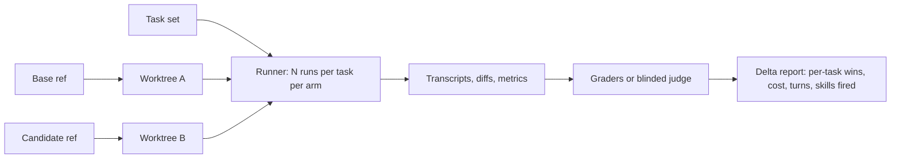

# A/B testing changes to magic: harness designs

Research date: 2026-11-20. Scope: how to compare two versions of this repo (for example `main` and a feature branch) and see how the change affects agent behavior in real work.

## Summary

Three designs follow, ordered from cheapest to closest to real work. They share one skeleton and differ in where the tasks come from and who decides which version did better.

| Design | Tasks come from | Verdict comes from | Build cost | Fidelity to your workflow |
| --- | --- | --- | --- | --- |
| 1. Scenario suite on `claude plugin eval` | Hand-written cases in `evals/` | Regex, tool-use, and model graders | Low | Low to medium |
| 2. Replay of your real tasks | Your past sessions | Blinded pairwise judge plus metrics | Medium to high | High |
| 3. Live split on real work | Whatever you do next | Passive metrics plus your own rating | Low | Highest, but slow to conclude |

Recommendation: build Design 1 first, grow it into Design 2, and use Design 3 only as passive tagging.

## What exists today

Nothing in the repo runs a model, so no current gate can tell you whether a change improves or degrades behavior.

- Every test is a static or offline check: `node:test` regex assertions on markdown, one Python `unittest`, and `scripts/validate.sh` (`README.md:143-147`, `.github/workflows/validate.yml:16-20`).
- A typical change is markdown prose plus a paired static test. In the last 15 commits, `skills/*/SKILL.md` changed in 8 and `rules/*.md` in 6.
- The kit already documents a manual version of this: a without-skill baseline, then a with-skill run, with "5+ reps per variant" and a no-guidance control (`skills/writing-skills/SKILL.md:276-305`).
- `skills/magic-mode/playbooks/eval.md:1-25` already specifies the experiment discipline: blinded prompts, one sanitized directory per variant, one judge scoring both variants in a single pass, and chain-following checked from transcripts.
- `skills/arena` and `skills/swarm` supply the parallel-candidate and worktree mechanics (`skills/arena/SKILL.md:17-29`, `skills/swarm/SKILL.md:22-24`).

## Facts that constrain every design

These findings change how any harness must be built.

- **Your sessions do not run your checkout.** Claude Code loads a cached copy installed from GitHub at commit `2843d2a` (`~/.claude/plugins/installed_plugins.json`). A local edit has no effect on your sessions until it is published and updated. A harness must load each version by path.
- **Load by path, isolate by config directory.** `claude -p --plugin-dir <path>` loads a checkout, and a fresh `CLAUDE_CONFIG_DIR` per run keeps the installed copy out ([CLI reference](https://code.claude.com/docs/en/cli-reference), [headless](https://code.claude.com/docs/en/headless)).
- **Do not use `--bare`.** Bare mode skips hooks of plugins loaded by flag, so the SessionStart bootstrap would not fire and both arms would run without routing ([headless](https://code.claude.com/docs/en/headless)).
- **The hook finds its own root.** `hooks/session-start:16-25` derives the plugin root from `$0`, so a worktree loaded by path injects its own `using-magic` text.
- **Runs are noisy.** One run per arm tells you little; plan for 3 to 5 repetitions per case per arm and compare medians.
- **Headless runs cannot ask you questions.** `AskUserQuestion` is absent in `-p` mode (`skills/magic-mode/references/harness-adapter.md:30`), so skills that stop to ask will behave differently than in live use.
- **Model choice stays outside the repo.** ADR-0001 bans model slugs in shipped files, so the harness takes the model from a flag or environment variable.
- **Claude Code first.** All three designs use Claude Code mechanics. The other four harnesses need their own runner.

## Shared skeleton

All three designs are the same pipeline with different inputs and judges.

Metrics available from every headless run ([Agent SDK reference](https://code.claude.com/docs/en/agent-sdk/typescript), [headless](https://code.claude.com/docs/en/headless)):

- Cost and tokens per model, including subagents (`modelUsage`).
- Turn count, wall time, error subtype, and permission denials.
- Every tool call in the stream, which shows which skills fired and which subagents were spawned.

## Design 1: scenario suite on `claude plugin eval`

Claude Code ships an eval runner for plugins, so the smallest harness is a suite of cases plus a script that runs it against two refs and diffs the results.

**How it works**

- Add `evals/<case>/prompt.md` with graders in `evals/<case>/graders/*.md` ([plugin evals](https://code.claude.com/docs/en/plugins/plugin-evals)).
- Grader types cover the three things this repo changes most:
  - Routing: `tool_used` on the `Skill` tool checks that the right skill fired.
  - Contract: `regex` checks output shape, such as a `## Why` section or a closing `## TL;DR`.
  - Quality: `llm` scores against a rubric.
- A script `scripts/ab <base> <candidate>` creates two worktrees, copies the same suite into both, runs `claude plugin eval <worktree> --ablation none --json` on each with the same model, and prints per-case deltas.
- The runner's default mode also compares with-plugin against no-plugin. That answers a second question: does this skill change anything at all? `skills/writing-rules/SKILL.md:140-148` already says to delete a rule the baseline obeys without it.

**Strengths**

- Least code: sandboxing, repetitions, cost ceiling, JSON output, and an HTML report are built in.
- Cases are committed, so each behavior change can ship with a case, the way changes ship with static tests today.
- Runs in CI with `--threshold` and `--max-cost-usd`, given an API key secret.

**Weaknesses**

- Cases are synthetic. They measure what you thought to write down, not what you do all day.
- The sandbox has no user settings, no `CLAUDE.md`, no personal MCP servers, and read-only tools by default, so it measures the plugin alone.
- Version-against-version is not built in. The two-run diff is glue you write.
- Short turn limits favor routing and format checks over long multi-step work.

**Unconfirmed**

- Whether a git worktree path is accepted as the eval target. A plain copy of the tree is the fallback.
- Whether `rules/*.md` load in a Claude Code plugin session at all. Only the Cursor manifest declares rules (`.cursor-plugin/plugin.json:21-24`).

## Design 2: replay of your real tasks with a blinded pairwise judge

This design measures your workflow directly by rerunning tasks you really did against both versions.

**How it works**

- Build a private corpus of 15 to 30 tasks from your own session history. Each entry holds the opening prompt, the target repo, and the commit that repo was on.
- For each task, arm, and repetition: check out the target repo at that commit in a temp directory, then run `claude -p --plugin-dir <arm worktree>` with a fresh `CLAUDE_CONFIG_DIR` and stream output.
- Capture the final answer, the diff, the transcript, and the metrics.
- A judge sees the two results under random labels and picks the better one against a rubric. This is `playbooks/eval.md` applied to plugin versions instead of models.
- The report lists win rate, metric deltas, and the tasks where the arms diverged most, so you read those transcripts yourself.

**Strengths**

- Answers the question you asked: how does this change affect my work?
- Catches side effects in skills you did not touch, because whole sessions run end to end.
- The runner command is the only harness-specific part, so other harnesses can be added later.
- Reuses conventions the kit already has.

**Weaknesses**

- Most build work: corpus extraction, environment setup per task, runner, judge, and report.
- Highest cost per comparison, since each run is a full task.
- Multi-turn sessions need a policy: replay only the first prompt, or script a simulated user.
- A judge's preference is not your preference. Rate a sample yourself and check agreement before trusting it.
- The corpus holds private prompts and must stay out of the repo. `harness-adapter.md:41` also forbids reading transcripts across workspaces, so extraction must be a deliberate step you run per project.

## Design 3: live split on real work

This is the literal A/B test: your real sessions are assigned at random to one version, and outcomes are compared over time.

**How it works**

- A launcher picks an arm per session, starts Claude Code with `--plugin-dir <arm>`, and tags the session with `OTEL_RESOURCE_ATTRIBUTES="variant=<arm>"` ([monitoring](https://code.claude.com/docs/en/monitoring-usage)).
- Hooks log per-session facts to a local file: skills invoked, subagents spawned, turn count, and how each session ended ([hooks](https://code.claude.com/docs/en/hooks)).
- A one-key rating at the end of a session supplies the outcome signal.
- A weekly report compares the arms. `/skill-doctor` adds per-skill usage and never-invoked warnings ([measure](https://code.claude.com/docs/en/plugins/measure)).

**Strengths**

- No corpus to curate and no simulation gap.
- Uses your full real setup, including settings, MCP servers, and interactive questions.
- The tagging part is cheap and useful on its own.

**Weaknesses**

- One person produces few sessions, and tasks differ, so only large effects show within weeks.
- You experience regressions in real work.
- Without the rating there is no outcome measure, only activity counts.
- The installed copy must be disabled so it does not load alongside the arm. Behavior when both share a name is unconfirmed.
- Not suitable as a merge gate, because the answer arrives after the decision.

## Recommendation

Start with Design 1, seed Design 2 from it, and keep Design 3 as tagging only.

1. Add `evals/` with 8 to 12 cases drawn from recent changes: PR routing (`efa4094`), the `## Why` requirement (`2843d2a`), the output-format contract (`01aad88`), and bootstrap routing.
2. Add the two-ref script and a delta table. This gives a usable pre-merge check for small cost.
3. Add 5 to 10 replayed real tasks with the pairwise judge once the runner is trusted. Grow the corpus each time a change surprises you in real use.
4. Turn on variant tagging in daily sessions so real usage data accumulates without making decisions depend on it.

## Open questions

These need your input or a quick experiment before building.

- Which harness is your daily driver? If it is not Claude Code, Design 1 measures the wrong thing and Design 2's runner changes.
- How are rules delivered in your real sessions? Six of the last 15 commits touch `rules/*.md`, and whether Claude Code plugin sessions load them is unconfirmed.
- What is an acceptable cost per comparison? That sets case count and repetitions.
- May your past sessions be used as a private task corpus?

## Sources

- Repo: `README.md`, `agents.md`, `CONTEXT.md`, `scripts/validate.sh`, `tests/*`, `hooks/*`, `skills/writing-skills/SKILL.md`, `skills/writing-rules/SKILL.md`, `skills/magic-mode/playbooks/eval.md`, `skills/magic-mode/references/harness-adapter.md`.
- Local check: `claude plugin eval --help` on Claude Code 2.1.329.
- Docs: [plugin evals](https://code.claude.com/docs/en/plugins/plugin-evals), [measure](https://code.claude.com/docs/en/plugins/measure), [headless](https://code.claude.com/docs/en/headless), [hooks](https://code.claude.com/docs/en/hooks), [monitoring](https://code.claude.com/docs/en/monitoring-usage), [Agent SDK plugins](https://code.claude.com/docs/en/agent-sdk/plugins), [skills](https://code.claude.com/docs/en/skills), [sessions](https://code.claude.com/docs/en/sessions), [CLI reference](https://code.claude.com/docs/en/cli-reference).
